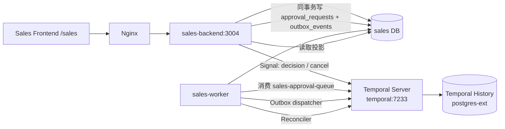

# 销售/营销管理平台工作流重构技术方案（Temporal 集成）

- 文档日期：2026-10-23
- 适用系统：`business/sales-service`（QW2 销售/营销管理平台）
- 关联文档：
  - `2026-10-21-tianma-sales-requirements-analysis.md`
  - `2026-10-22-sales-qw2-foundation-design.md` §1.3、§9.4
- 目标：把审批从“业务库状态机 + 定时扫描”重构为“Temporal 编排 + 业务库投影”，先完成审批域，再逐步扩展到营销活动编排。

---

## 1. 结论

对于营销管理平台，**Temporal 应该集成，但只集成在“审批与长流程编排”层，不做全平台 Temporal 化**。

本方案的核心判断：

1. 审批是跨人、跨天、可能退回/转办/超时、必须可恢复的流程，适合 Temporal。
2. 商机九段状态机、规则校验、待办查询、工作台、主数据、AI 生成等仍是同步业务，继续留在 `sales-backend` + `sales` 库。
3. `sales` 库是**业务事实与审批投影**的权威；Temporal 是**流程状态、定时器和重试**的权威。
4. 通过 Transactional Outbox 解决“数据库成功、工作流丢失”的双写问题。
5. 通过幂等 Activity、固定 Workflow ID、Reconciler 保证“Temporal 已通过、页面还显示审批中”不会长期存在。
6. Temporal 不可用时，审批请求可以落 `pending_start`，但**绝不能静默通过**。

---

## 2. 现状审计

`business/sales-service` 已经有一版 Temporal 集成骨架：

```text
app/workflows/
├── client.py        # Temporal Client、启动/信号
├── contracts.py     # ApprovalWorkflowInput / DecisionSignal / CancellationSignal
├── workflow.py      # SalesApprovalWorkflow
├── activities.py    # 幂等投影活动
└── dispatcher.py    # Outbox dispatcher
app/worker.py        # Temporal Worker 入口
```

已有能力：

- `SalesApprovalWorkflow`：顺序审批、通过/驳回/退回/取消、SLA 超时升级、转办。
- `SalesApprovalWorkflow` 的信号：`decision`、`cancel`。
- Outbox：审批请求与 `outbox_events` 同事务写入，dispatcher 启动工作流。
- 审批投影：`approval_requests`、`approval_steps`、`approval_actions`。
- API：发起审批、待我审批、详情、决策、取消、重试启动。
- Compose：`sales-backend`、`sales-worker`、Temporal 容器、Temporal UI、Nginx `/sales` 与 `/temporal/`。

但仍存在以下生产级缺口：

| 缺口 | 影响 | 本方案处理 |
|---|---|---|
| 整体 7 天过期未真正进入 Workflow | 页面显示 `expires_at`，但流程可能继续运行 | 把 `expires_at_epoch` 写入 Workflow 输入，由 Workflow Timer 统一收敛 |
| Outbox 没有最大重试/失败终态 | 事件可能无限重试，审批永远 `pending_start` | 增加最大尝试次数、失败状态、告警与人工重试 |
| 没有 Reconciler | Temporal 已完成、DB 可能长期不一致 | 增加定时对账，按 Workflow 状态补写终态 |
| API 进程也启动 dispatcher，Worker 也启动 | 多进程重复扫描；职责边界不清 | 生产只由 `sales-worker` 承担 dispatcher/reconciler；API 只写 Outbox |
| `escalate_step` 未关闭旧待办、未清理指定审批人 | 升级后出现两个待办，原转办人仍可操作 | 升级时关闭旧待办、清理 `approver_id` |
| `activate_step` 在 Activity 重试时可能给已结束步骤重新开待办 | 重试产生脏待办 | 对步骤状态做前置判断，终态直接返回 |
| `mark_failed` 未关闭待办/通知 | 失败审批仍占用待办 | 失败终态统一收口 |
| 健康检查只报告配置，不报告实际连接 | 运维无法判断 Temporal 是否可用 | `/health` 增加实际连接探测 |
| 缺少 Temporal 层测试 | 回归只能靠手工 | 增加契约/策略/工作流逻辑测试；部署环境跑时间跳跃验收 |
| 审批模板的 `parallel_all/parallel_any` 尚未实现 | 后续会签/或签需要改工作流 | 本期契约保留 `mode`，先落顺序审批；会签作为下一迭代 |

---

## 3. 目标与非目标

### 3.1 目标

- 审批流程由 Temporal 持久化执行，API/Worker 重启不丢流程。
- 审批 SLA、升级、过期由 Temporal Timer 驱动，不依赖数据库轮询。
- 审批决定、取消、转办通过 Signal 进入工作流；所有数据库写入在 Activity 中完成。
- 审批投影与业务事实保持最终一致，并提供对账与降级路径。
- 现有前端 API 与页面语义不变，避免业务侧大改。
- 方案可扩展到 R4、R6、撞单合并之外的其他审批模板。

### 3.2 非目标

- 不把商机阶段推进、规则引擎、工作台查询搬进 Temporal。
- 不让 Temporal 直接访问 `sales` 数据库。
- 不在本期实现任意可视化流程设计器；审批模板仍由 `approval_definitions` 配置。
- 不在本期实现跨系统 Saga/补偿；外部系统接入仍走 Port/Adapter。

---

## 4. 目标架构



### 4.1 职责边界

| 组件 | 负责 | 不负责 |
|---|---|---|
| `sales-backend` | 鉴权、业务校验、创建审批单、写 Outbox、查询投影、发 Signal | 不跑 Workflow、不扫描 Outbox、不做 SLA 定时 |
| `sales-worker` | Temporal Worker、Outbox dispatcher、Reconciler、Activity 执行 | 不对外提供页面 API |
| Temporal | Workflow 状态、Timer、重试、History、Signal 队列 | 不存业务事实、不直接写业务库 |
| `sales` DB | 审批单/步骤/动作投影、商机、待办、审计 | 不作为流程定时器 |

### 4.2 运行拓扑

```text
sales-backend (API, 可水平扩展)
  ├─ POST /opportunities/{id}/approvals
  │    ├─ 校验闸门与权限
  │    ├─ 写 approval_requests(status=pending_start)
  │    └─ 同事务写 outbox_events(approval.start)
  ├─ POST /approvals/{id}/decision  -> Temporal Signal
  └─ POST /approvals/{id}/cancel    -> Temporal Signal

sales-worker (单实例或少量实例)
  ├─ outbox_dispatcher：SELECT ... FOR UPDATE SKIP LOCKED
  ├─ Temporal Worker：SalesApprovalWorkflow + Activities
  └─ reconciler：running 超过 2 分钟的记录与 Temporal 对账

eai-flow-temporal
  ├─ Workflow History
  ├─ Timers / Signals
  └─ Temporal UI（Nginx /temporal/，仅运维可见）
```

---

## 5. 领域模型与状态机

### 5.1 审批状态

```text
pending_start -> running -> approved
                    ├── rejected
                    ├── returned
                    ├── cancelled
                    ├── expired
                    └── failed
```

- `pending_start`：数据库已落库，Outbox 尚未成功启动 Workflow。
- `running`：Workflow 已启动，等待当前步骤决策。
- `approved`：全部步骤通过；只写闸门证据，不自动推进商机。
- `rejected` / `returned`：终态；退回表示申请人补充材料后重新发起。
- `cancelled`：申请人/管理员撤回。
- `expired`：整体或步骤超时；**不自动通过**。
- `failed`：启动失败或不可恢复错误，需管理员处理。

### 5.2 步骤状态

```text
pending -> active -> approved
                  ├── rejected
                  ├── returned
                  ├── skipped
                  └── expired
```

- `active` 时必须有当前待办和 SLA。
- `delegate` 不结束步骤，只更换审批人并重置该步骤时钟。
- 终态后，后续 `pending` 步骤统一置 `skipped`。

### 5.3 闸门语义

- R4：新客户集团无示范面，可申请例外审批。
- R6：关联方交易，必须走合规审批。
- DUPLICATE / R10：撞单合并/仲裁。
- 审批通过只解除闸门，不自动推进商机阶段；用户必须重新提交 `transition`。

---

## 6. Temporal 工作流设计

### 6.1 Workflow 输入

`ApprovalWorkflowInput`：

```python
@dataclass
class WorkflowStep:
    step_no: int
    approver_role: str
    sla_hours: int
    approver_id: str | None = None
    mode: str = "sequential"

@dataclass
class ApprovalWorkflowInput:
    request_id: str
    request_no: str
    opportunity_id: str
    gate_code: str
    requested_by: str
    steps: list[WorkflowStep]
    expires_at_epoch: float | None = None
```

约束：

- Workflow 代码只 import `temporalio`、标准库和 DTO。
- 不在 Workflow 中读数据库、发 HTTP、读环境变量、生成随机数。
- 所有时间使用 `workflow.now()` 或 `workflow.wait_condition(timeout=...)`。
- 所有 DB 写入、通知、审计都在 Activity 中完成。

### 6.2 主循环

```text
mark_running
for step in steps:
    if cancelled: finalize(cancelled)
    if expired: finalize(expired)
    activate_step(step)
    wait decision or cancel, timeout = min(step SLA, 剩余整体时限)
    on timeout:
        escalate_step
        wait 4h or remaining
        on timeout: finalize(expired)
    if delegate:
        delegate_step; 重新等待
    if reject:  finalize(rejected)
    if return:  finalize(returned)
    if approve: continue
finalize(approved)
```

### 6.3 信号

| 信号 | 参数 | 说明 |
|---|---|---|
| `decision` | `step_no, action, actor_id, actor_role, comment, idempotency_key, delegate_to` | 通过/驳回/退回/转办 |
| `cancel` | `actor_id, reason` | 申请人/管理员撤回 |

- `decision` 按 `step_no` 去重：同一活动步骤只接受第一个决策。
- 决策 API 使用 `idempotency_key` 唯一约束，重复点击返回已有结果。
- Signal 只是“提交意愿”；最终状态以 Activity 写投影为准。

### 6.4 SLA 与升级

- 每个步骤 `sla_hours`（R4/R6 默认 24/24/48）。
- 到 SLA：`escalate_step`，升级角色，关闭旧待办，创建升级待办，通知。
- 升级后再等待 4 小时；仍未处理则 `expired`。
- 整体 `expires_at` 默认 7 天；任何步骤等待不得超过剩余整体时限。
- `expired` 不自动通过，闸门保持阻断。

### 6.5 重试与超时

建议 Activity 策略：

```text
ScheduleToStart: 5 minutes
StartToClose:    60 seconds
Retry:           maximum_attempts=5
                 initial_interval=2s
                 backoff=2.0
```

- 业务异常（例如“步骤已决定”）使用 `ApplicationError(non_retryable=True)`，避免无意义重试。
- Activity 失败不会让 Workflow 直接改业务库；Workflow 捕获不可恢复异常后调用 `mark_failed` 并结束。
- 所有 Activity 必须幂等；重复执行不得创建重复待办/通知/动作。
- 所有 Temporal RPC（启动、Signal、Describe）设置 `TEMPORAL_RPC_TIMEOUT_SECONDS`（默认 5 秒）硬超时；客户端断连时 Outbox 记录失败并退避，不允许 dispatcher 被单次 RPC 永久挂起。

---

## 7. Outbox 与一致性

### 7.1 可靠启动

```text
API 事务:
  INSERT approval_requests(status=pending_start)
  INSERT outbox_events(event_type=approval.start, status=pending)
COMMIT

Worker:
  SELECT ... FROM outbox_events
  WHERE status='pending' AND next_retry_at <= now()
  ORDER BY created_at
  FOR UPDATE SKIP LOCKED
  -> start_workflow(
       id=sales-approval-{request_id},
       id_reuse_policy=ALLOW_DUPLICATE_FAILED_ONLY,
       rpc_timeout=5s
     )
  -> event.status=processed
```

- 固定 Workflow ID，保证重复消费不会创建多个工作流。
- 启动成功但 Activity 尚未执行时，请求保持 `pending_start`；`mark_running` 后变 `running`。
- 启动失败：`attempts++`，指数退避（10s/20s/40s... 上限 300s）。
- 超过 10 次：`outbox_events.status=failed`，`approval_requests.status=failed`，记录 `failure_reason`，等待管理员 `retry`。
- 启动 RPC 使用外层硬超时，避免 Temporal 断连时 dispatcher 卡死；超时按普通启动失败处理。

### 7.2 幂等键

| 对象 | 幂等键 |
|---|---|
| 启动 | `sales-approval-{request_id}` |
| 步骤待办 | `approval:{request_id}:step:{step_no}` |
| 升级待办 | `approval:{request_id}:step:{step_no}:esc:{level}` |
| 审批动作 | 前端 `idempotency_key`，数据库唯一 |
| 通知 | `approval-active:{request_id}:{step_no}` 等 |
| 审计 | `request_id + action + step_no` |

### 7.3 对账

`reconciler` 每 5 分钟执行：

1. 查询 `status in (pending_start, running)`、`workflow_id` 非空且 `updated_at < now()-2min` 的审批。
2. 调用 `handle.describe()`。
3. 若 Temporal 已终态：
   - `COMPLETED`：读取 `handle.result()`，按 `approved/rejected/returned/cancelled/expired` 补写投影。
   - `FAILED/TERMINATED/TIMED_OUT`：写 `failed`/`expired`，关闭待办，通知发起人。
4. 若 Workflow 不存在：写 `failed`，不自动通过。
5. Temporal 不可达：跳过本轮，不修改业务库。

---

## 8. 失败、降级与安全

### 8.1 降级矩阵

| 场景 | 行为 |
|---|---|
| `TEMPORAL_ENABLED=false` | 审批发起返回 503；不创建无法执行的审批 |
| Temporal 暂时不可达 | 审批请求可落 `pending_start`；Outbox 重试；页面显示“等待审批引擎” |
| Worker 重启 | Temporal History 保留；Worker 恢复后继续 |
| API 重启 | 不影响 Workflow；页面从 DB 投影读取 |
| Workflow 完成但 DB 未终态 | Reconciler 5 分钟内补写 |
| DB 显示 running 但 Workflow 不存在 | 标记 failed，通知管理员，不自动通过 |
| 重复点击审批 | `idempotency_key` 去重，返回已有结果 |

### 8.2 安全

- 只有 `sales-backend` 能连接 Temporal；Temporal 不暴露公网。
- 决策 API 校验：登录、`sales.approval.decide`、数据范围、当前步骤、角色/指定人。
- 默认禁止自批？当前业务允许自批；如需要禁止，在 `approve_decision` 增加 `requested_by == identity.user_id` 校验。
- 审批历史不可删除；`cancelled`/`returned` 也保留。
- 附件仍走 MinIO + 销售服务鉴权下载。

---

## 9. 代码改造清单

### 9.1 后端

| 文件 | 改造 |
|---|---|
| `app/workflows/contracts.py` | 增加 `expires_at_epoch`、`mode`；保持可序列化 |
| `app/workflows/workflow.py` | 整体过期、取消、升级、终态统一；使用 `workflow.now()` |
| `app/workflows/client.py` | 固定 ID、`ALLOW_DUPLICATE_FAILED_ONLY`、连接探测、RPC 硬超时、`describe` 辅助 |
| `app/workflows/dispatcher.py` | 最大重试、失败终态、指数退避、结构化日志 |
| `app/workflows/reconciler.py` | 新增；对账 running 审批与 Temporal 状态 |
| `app/workflows/activities.py` | 激活/升级/失败/终态幂等与清理 |
| `app/worker.py` | Worker + dispatcher + reconciler；生产唯一后台入口 |
| `app/app.py` | API 不再启动 dispatcher；保留 scheduler 或迁移到 worker |
| `app/routers/approvals.py` | 去掉 API 内直接 `dispatch_once`；只写 Outbox/发 Signal |
| `app/routers/health.py` | 增加 Temporal 实际连接状态 |
| `app/approval_service.py` | 输入组装包含整体过期；决策/取消保持 Signal 语义 |

### 9.2 部署

- `docker-compose.business.yaml`：
  - `sales-worker` 运行 `python -m app.worker`。
  - `sales-backend` 设置 `SALES_EMBEDDED_WORKER=false`。
  - 生产 `SCHEDULER_ENABLED=true`（或拆独立 scheduler），advisory lock 保证单实例。
- `docker-compose.temporal.yaml`：保留 Temporal Server + UI。
- Nginx：保留 `/sales/api/`、`/sales/`、`/temporal/`。
- 环境变量：`TEMPORAL_ENABLED`、`TEMPORAL_URL`、`TEMPORAL_NAMESPACE`、`TEMPORAL_TASK_QUEUE`、`TEMPORAL_RPC_TIMEOUT_SECONDS`。

### 9.3 前端

- 审批页继续读投影，不直接查 Temporal。
- 状态标签增加 `pending_start`、`expired`、`failed` 的运维提示。
- `retry` 按钮只对 `pending_start/failed` 显示。
- `retry` 是显式的新一次尝试：从创建快照恢复步骤角色/SLA，清空投影决策并从第 1 步重跑；绝不把失败当通过。
- 决策提交后轮询详情，直到投影状态变化；不本地推断通过。

---

## 10. 迁移与发布

### 10.1 分阶段

| 阶段 | 内容 | 退出条件 |
|---|---|---|
| P0 文档与契约 | 本方案、DTO、状态机 | 评审通过 |
| P1 后端加固 | Outbox、Reconciler、过期、幂等 | 单测通过；本地 Temporal 可跑 |
| P2 部署联调 | Temporal + Worker + API + UI | R4/R6/撞单三条链路通过 |
| P3 灰度 | 仅新审批走 Temporal；存量审批只读 | 无 P0/P1 故障 |
| P4 扩展 | 会签/或签、报价/合同审批模板 | 新模板验收通过 |

### 10.2 数据迁移

- 不迁移历史 Temporal History；历史审批保留在 `approval_requests`/`approval_actions`。
- 存量 `running` 审批：
  - 若已有 `workflow_id`，继续由 Worker 接管；
  - 若没有，标记 `failed` 并由管理员重试，避免“假 running”。
- 新增字段通过 Alembic（当前 `create_all` 仅用于 Sprint 0）：
  - 本方案 DTO 变更不涉及数据库字段；
  - 若后续增加 `sla_hours`、`mode` 到步骤表，补 migration。

### 10.3 回滚

- 关闭 `TEMPORAL_ENABLED` 后，新审批请求返回 503，不会创建半成品。
- 已启动 Workflow 可继续由 Worker 完成；停止 Worker 只暂停执行，不丢 History。
- 前端仍可读历史投影。
- 不建议回滚到“API 内内存工作流”。

---

## 11. 测试策略

### 11.1 单元测试（离线）

- DTO 序列化/反序列化。
- `workflow_input_for` 的 SLA、整体过期时间。
- Outbox 退避、最大重试、失败终态。
- Reconciler 状态映射。
- 审批状态机纯函数（步骤激活、终态收敛）。

### 11.2 工作流测试（时间跳跃）

使用 `temporalio.testing.WorkflowEnvironment.start_time_skipping()`：

- 顺序通过。
- 第一步驳回。
- 第一步退回。
- 取消。
- 24h 未处理 -> 升级 -> 4h 未处理 -> expired。
- 转办后时钟重置。
- 整体 7 天过期。
- 重复 Signal 幂等。
- Activity 重试不产生重复待办。

> 该测试需要 Temporal 测试服务器二进制；CI 可缓存，离线环境需预置。

### 11.3 集成测试（Compose）

- 发起 R4 -> Outbox -> Workflow -> 待办 -> 通过 -> 闸门证据。
- Temporal 停机 -> 请求 `pending_start` -> 恢复 -> 自动启动。
- Worker 重启 -> Workflow 继续。
- Temporal 完成但 DB 终态未写 -> Reconciler 补写。
- 重复点击审批 -> 只产生一条 `approval_actions`。

### 11.4 验收清单

- [x] R4 例外审批全链路通过。
- [x] R6 关联方审批三步通过。
- [x] DUPLICATE 闸门审批通过（单步）。
- [x] 取消终态正确；驳回/退回/过期由工作流测试覆盖。
- [ ] 24h SLA 升级、4h 后再过期可模拟。
- [ ] 整体 7 天过期不自动通过。
- [x] Temporal 不可用时请求不丢、页面提示明确。
- [x] Worker 重启后流程继续。
- [x] Reconciler 能修复“Temporal 完成、DB running”。
- [x] 审批页不直接依赖 Temporal Query。
- [x] 所有决策有 `idempotency_key` 且重复提交安全。

---

## 12. 风险与对策

| 风险 | 对策 |
|---|---|
| Workflow 代码非确定性导致 replay 失败 | 禁止读时间/随机/DB/环境；CI replay 测试；使用 `workflow.patched` |
| Outbox 积压 | 监控 pending 数、最老事件年龄；退避上限；管理员 `retry` |
| Temporal 运维复杂 | 复用现有 `eai-flow-temporal`；Temporal UI 仅运维；健康检查 |
| 双写不一致 | Outbox + 幂等 Activity + Reconciler |
| 审批模板变更影响运行中流程 | 发起时快照 `steps_json` 到 Workflow 输入；运行中不读模板 |
| 多副本重复升级 | Temporal Timer 唯一；A02 调度器跳过 `type=approval` |
| 会签/或签需求 | 契约保留 `mode`；下一迭代在 Workflow 内按步骤聚合决策 |

---

## 13. 与之前 `workflow/` 复刻子系统的关系

`workflow/` 是 warm-flow 风格的审批状态机，适合固定审批流、人工待办和简单退回/转办；它没有 Temporal 的持久化 Timer、Outbox、Activity 重试、History Replay 和分布式 Worker。

因此：

- 营销平台 QW2 审批：使用 `business/sales-service` + `eai-flow-temporal`。
- 简单内部审批/流程定义演示：继续使用 `workflow/`。
- 两套系统不共享表、不共享模型、不互相调用。

---

## 14. 实施状态

本方案随代码落地时，以下项已纳入实现：

- [x] DTO 增加整体过期时间。
- [x] Workflow 整体过期与取消。
- [x] Outbox 最大重试与失败终态。
- [x] Reconciler。
- [x] Worker 统一承载 dispatcher/reconciler。
- [x] API 移除直接 dispatcher 调用。
- [x] 升级/失败/激活的幂等清理。
- [x] 失败重试从创建快照恢复步骤并从第 1 步重跑。
- [x] 指派/转办步骤按 `approver_id` 收窄可见与操作权限。
- [x] Temporal RPC 硬超时，断连时 Outbox 正常退避。
- [x] `/health` Temporal 连接探测。
- [x] 离线单元测试。
- [x] Compose 全链路验收（R4/R6/DUPLICATE、取消、重试、Temporal 停机恢复、Reconciler）。

仍需在具备 Temporal 测试服务器的环境执行：

- [ ] 时间跳跃工作流测试（依赖 Temporal 测试服务器）。
- [ ] 会签/或签模板实现。

### 14.1 离线验证记录（2026-10-24）

在 `business/sales-service/backend` 执行：

```powershell
.\.venv\Scripts\python.exe -m pytest -q
# 25 passed

.\.venv\Scripts\python.exe -m ruff check app tests
# All checks passed!

.\.venv\Scripts\python.exe -m ruff format --check app tests
# 35 files already formatted

.\.venv\Scripts\python.exe -m compileall -q app tests
# compileall ok
```

覆盖：契约快照、整体过期计算、Outbox 退避与耗尽终态、Temporal 终态映射、升级/转办/幂等冲突边界、失败重试快照恢复、RPC 硬超时。

### 14.2 Compose 联调记录（2026-10-24）

Docker/Temporal 可用后，通过 Nginx 入口 `http://localhost:2026/sales/api` 使用真实 EAI JWT 执行：

- R4 两步顺序审批：`pending_start -> running -> step1 active -> step2 active -> approved`；Outbox 事件 `processed`，两条 `approval_actions`，两个待办均 `resolved`。
- R6 三步顺序审批：三步依次激活并通过，最终 `approved`；Temporal Workflow `COMPLETED`，结果为 `approved`。
- DUPLICATE 闸门单步审批通过。
- 取消：运行中取消后 `cancelled`，当前步 `cancelled`，后续步骤 `skipped`。
- 重复提交：同一 `idempotency_key` 返回已有结果，不新增 Action；跨审批复用同一键返回 `SALES-409-IDEMPOTENCY_KEY`。
- 转办：`delegate_step` 后步骤 `approver_id=demo-manager`，原待办 `resolved`，新待办指派给受转办人；后续由管理员继续推进。
- 失败重试：模拟 `failed` 后调用 `/retry`，步骤从创建快照恢复为 `pending`，整体时限重置 7 天，重新启动并完成三步审批。
- Temporal 停机：请求保持 `pending_start`；恢复后 Worker 自动启动。Worker 已连接时停机，Outbox 记录 `Temporal start_workflow 超时` 并按退避重试（观察到 attempts=2），Temporal 恢复后自动 `processed -> running`。
- Reconciler：手工将已完成审批改回 `running` 且 `updated_at` 置为 10 分钟前，调用 `reconcile_once()` 后补写为 `approved`。
- Worker 重建后从 Temporal History 继续，未丢失运行中流程。

未执行：时间跳跃测试（当前无 Temporal 测试服务器二进制）；24h SLA 升级、4h 再过期、整体 7 天过期的真实时钟验证依赖该测试或长时间等待。

> 当前机器 Docker daemon 已启动；若后续再次离线，先执行 `docker start` 或启动 Docker Desktop，再运行 11.2/11.3。
